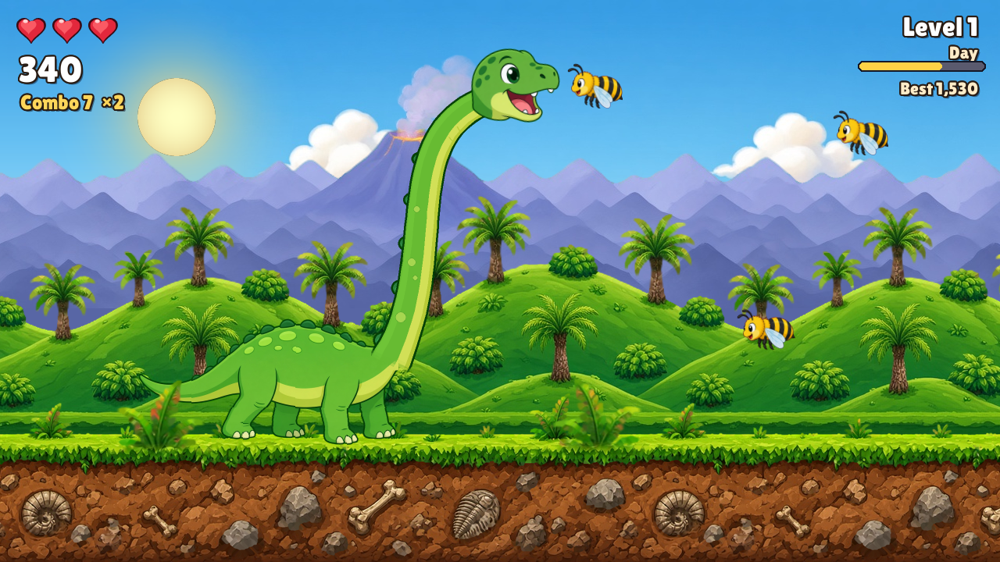

# Dinosaur vs Bees (Remake)

A finished, polished remake of [Dinosaur vs Bees](https://github.com/brixham99/Dinosaur-vs-Bees),
written in Python with Pygame.

A long-necked sauropod strolls through a prehistoric valley while bees drift in from the right.
Raise and lower his neck to snap up the yellow bees, but steer clear of the angry red ones and
don't let any bee bump into his head, neck or body without being eaten, or he gets stung.



## How to play

| Key | Action |
| --- | --- |
| Up / W | raise the neck |
| Down / S | lower the neck |
| Space | chomp |
| P / Esc | pause (Esc on the title screen quits) |
| Enter | start / play again |
| M | sound on / off |
| F3 | show the collision shapes (debug) |

* **Yellow bees**: chomp them while they are at his mouth for 10 points times your combo
  multiplier. Every 5 eats in a row adds one to the multiplier (up to ×5).
* **Angry red bees** can never be eaten. Chomping one stings too, so steer the neck around them.
* **Golden bees** turn up now and then from level 3. Eat one to win back a heart (or a big bonus
  if your hearts are full).
* A bee that touches his head without a chomp, or hits his neck or body, stings him. He loses a
  heart, flinches and blinks for a moment while he can't be hurt. Three hearts and it's game over.
* Yellow bees that slip past uneaten don't hurt, but they break your combo.
* Every 12 bees eaten you go up a level. Bees get faster and more numerous, red bees turn up more
  often, and from level 3 swarms arrive in lines, V shapes and sine-wave snakes. The scenery
  cycles through **Day, Sunset, Night and Volcano Glow**, then round again on a harder ramp.
* Your best score is saved to `highscore.json` next to the game.

## Running it

```bash
pip install -r requirements.txt
python3 game.py
```

The window is 1280×720 at 60 FPS. Sound effects are made with numpy at startup. If no audio
device is available, the game runs silently.

### Options (handy for testing)

```
--seed N            repeatable run
--autoplay          let the demo AI play (steers to yellow bees, away from red ones)
--frames N          quit after N frames (runs flat out when headless)
--screenshot PATH   save a screenshot when the run ends
--shots F:PATH,...  save screenshots at the given frame numbers
--level N           start on level N
--mute              start with the sound off
--hitboxes          draw the collision shapes
--highscore-file P  keep the high score somewhere else
```

Headless example:

```bash
SDL_VIDEODRIVER=dummy SDL_AUDIODRIVER=dummy python3 game.py --seed 3 --autoplay --frames 5000 --screenshot out.png
```

## Project layout

```
game.py                main loop, states, collisions, scoring, HUD and screens
dinobees/settings.py   tuning constants
dinobees/assets.py     loading, fonts, themes and colour grading
dinobees/world.py      parallax layers, sun and moon, stars, volcano glow, foreground ferns
dinobees/dino.py       dinosaur: walk cycle, procedural neck, head, hitboxes
dinobees/bees.py       bee art, flight patterns and the level-driven spawner
dinobees/ai.py         autoplay demo pilot
dinobees/sfx.py        synthesised sound effects
dinobees/ui.py         text, hearts and panels
tools/prep_assets.py   reproducible chroma-key, crop and seamless-tiling pipeline for the art
tools/capture_shots.py stages key moments and saves screenshots (headless)
tools/bench.py         frame-time benchmark
assets/                processed PNG sprites and parallax layers, plus the font
```

The neck is drawn in code each frame as a tapered Bézier curve, with the body's greens, a pale
underside stripe, spots and a dark outline, and the head sprite follows its angle. The parallax
layers (sky, mountains, hills, ground and a near layer of ferns) were made seamlessly tileable
with a minimum-cost seam blend. To rebuild them, put the raw art JPGs in `raw/` (`body.jpg`,
`heads.jpg`, `bees.jpg`, `sky.jpg`, `mountains.jpg`, `hills.jpg`, `ground.jpg`) and run
`python3 tools/prep_assets.py`.

## Credits

* Remake of **Dinosaur vs Bees** by brixham99: <https://github.com/brixham99/Dinosaur-vs-Bees>.
  The original was a scrolling scene with a sauropod, bees and three procedural parallax layers.
  This remake keeps the idea and the parallax feel and turns it into a full game.
* Font: [Lilita One](https://fonts.google.com/specimen/Lilita+One) by Juan Montoreano, SIL Open
  Font License 1.1 (see `assets/fonts/OFL.txt`).
